# How the code fits together

You already know what Unmouse does. This is where each behavior lives, and the few mechanics that are easy to break.

## Two modules

`UnmouseCore` is everything that can run without a window: config, shortcuts, grid math, hint codes, the speed curve, the tutorial steps. `Unmouse` is the menu-bar app: events, the pointer, overlays, settings. Tests import `UnmouseCore` only.

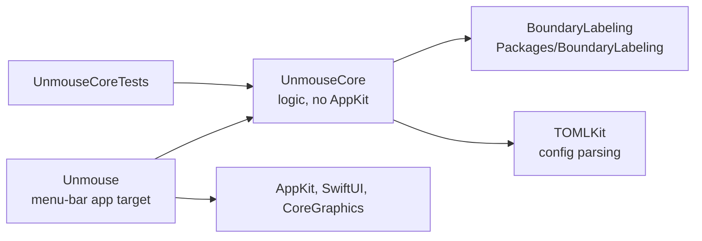

`UnmouseCore` does not import AppKit. A function that needs a window, an event tap, or a permission stays in `Unmouse`. `Packages/BoundaryLabeling` places hint labels and knows nothing about Unmouse.

Inside the app, `AppModel` is the object the others are handed. `NavigationModel` keeps it `unowned` (the app owns navigation and outlives it). `TutorialModel` and `OverlayController` keep it `weak`. Views take `AppModel`. Core never mentions the app. Inside the app, though, `AppModel` and its helpers point at each other (`AppModel` → `NavigationModel` → `AppModel`), so the app layer does contain a reference loop. It is not a retain cycle, because the back-edges are `unowned` or `weak`, but it is a dependency loop.

The app target is `@MainActor` by default. The event tap and the Karabiner listener are both scheduled on the main run loop, so their callbacks are already on that actor.

## Repo layout

| Path | What it is |
|---|---|
| `Sources/Unmouse/` | AppKit app. Folders below under "Where to look" |
| `Sources/UnmouseCore/` | Logic the tests cover. Folders below under "Where to look" |
| `Tests/UnmouseCoreTests/` | Tests for `UnmouseCore` |
| `Packages/BoundaryLabeling/` | Label layout. Its own package and tests |
| `configs-example/` | The only preset copy. Scripts put it in `Unmouse.app` |
| `Support/Info.plist` | Info.plist the app bundle uses |
| `scripts/dev-app.sh` | Release build, wrapped and signed as `Unmouse.app` |
| `scripts/release.sh` | Version, sign, notarize, and tag. See [release.md](release.md) |

## Where to look

`Sources/UnmouseCore/`

| Folder | What it owns |
|---|---|
| `Config/` | The TOML model, bindings, load/save, validation |
| `Input/` | Shortcut parsing, modes, held keys, alone-tap, click chaining, the Z/X latch |
| `Grid/` | Grid state, label assignment, the aim guide |
| `Hint/` | Hint codes, bubbles, typing state. Layout calls `BoundaryLabeling` |
| `Motion/` | The speed curve, and the posted-pointer aim |
| `Tutorial/` | Sessions, steps, and the progress machine |
| `Support/` | AppKit to CGEvent coordinates, the log gate, `clamped(to:)` |

`Sources/Unmouse/`

| Folder | What it owns |
|---|---|
| `App/` | `main`, the menu bar, `AppModel` (config, permissions, login item) |
| `Input/` | The event tap, Karabiner, `NavigationModel`, parsed bindings, free-mode ticking |
| `Pointer/` | Posting moves, clicks, and scrolls |
| `Overlay/` | The panels, and the accessibility scan that feeds hints |
| `Tutorial/` | The live session and the practice window |
| `Windows/` | The shared host for Settings, setup, and practice |
| `Views/` | SwiftUI and AppKit views, split into `Overlay`, `Settings`, `Tutorial`, `Menu` |

## Startup

`App/main.swift` runs `NSApplication` as an accessory (no Dock icon) and sets `AppDelegate`. `AppDelegate` puts the status item in the menu bar and calls `AppModel.start`.

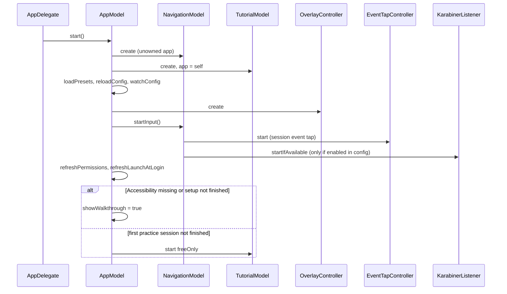

## A key, from the keyboard to an action

Two sources see the same physical key.

- `EventTapController` is a session event tap at the head of the queue. It sees key down, key up, flags, and mouse down. It is the only source of modifiers.
- `KarabinerListener` reads Karabiner's virtual keyboard and never seizes it. It ignores modifiers. Modifiers are owned by the tap, because a second report of ⌘ or ⌥ races the tap's alone-tap detection.

`NavigationModel.handleKey` is the only place a key becomes a mode action.

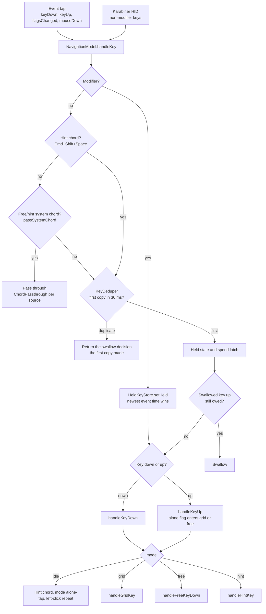

Rules that the diagram does not show:

- Modifiers are never swallowed by the tap, whatever `handleKey` returns. A missing key-up leaves ⌘, ⌥, ⌃, or ⇧ held in every app.
- A swallowed non-modifier key down remembers its token in `swallowUpToken`, so the matching key-up and any repeats are swallowed too.
- `ChordPassthrough` keeps one slot per source. The source that passed the key-down must pass its own key-up. Sharing one slot makes the tap swallow Tab, and macOS then ignores the next ⌘-Tab.
- `AloneTapTracker` (inside the tap) decides a solo modifier tap. Another key, another modifier, or a hold longer than `tap_max_ms` cancels it. The key-up arrives with `alone: true`.
- Mouse-down in free calls `endFreeModeIfNeeded`, which leaves free only when `exit_on_action` is on.
- In hint, ⌘⌥⌃ plus another key leaves and passes through (`passSystemChord`), except hint-owned ⌘T and ⌘0–9. Free still uses the same path; exit there stays gated by `exit_on_action`.

### Mode transitions

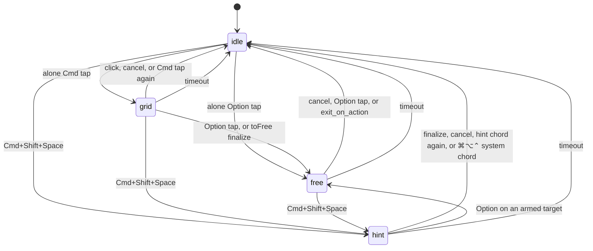

`mode_timeout_s` returns any mode to idle when no input arrives. The watcher checks four times a second. Dragging keeps the drag: leaving grid or hint while dragging goes back to free, not idle.

## Grid

`GridState` is the grid. It holds a stack of levels. The first level is the screen. Typing a character that matches a label prefix appends it. When the prefix is a whole label and a deeper level is allowed, `descend()` pushes that cell as the new level and switches the division to `subRows` × `subCols`.

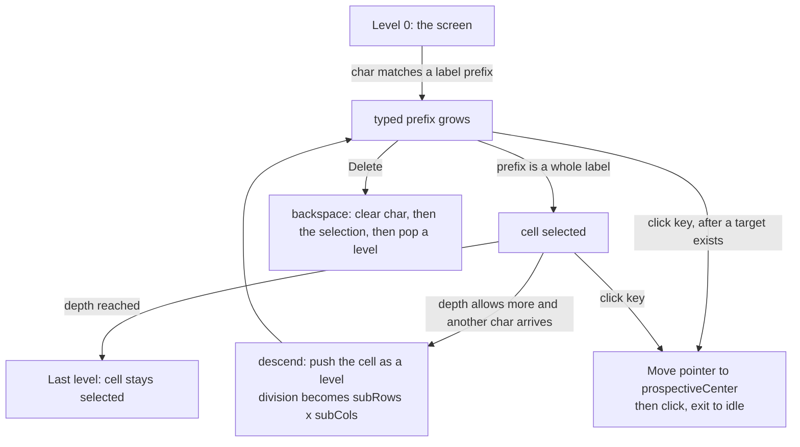

`GridLabels` picks the label width. One character when the alphabet can give every cell its own key. Two when the cells tile into blocks (first key names the block, second names the cell). Three when two are not enough. `GridInputRouter` is the pure decision: cancel, back, next screen, then a click once any rectangle is targeted, otherwise type the character. A click is legal after the first character of a two-character label. The pointer moves to `prospectiveCenter`, the middle of every cell that still matches what was typed.

`depth` is 1...3. Backspace undoes one step at a time: a character, then a finished cell, then a level.

## Free

Movement is not per key event. `DisplayLinkDriver` ticks `FreeMotion.tick` once a frame while free mode is up.

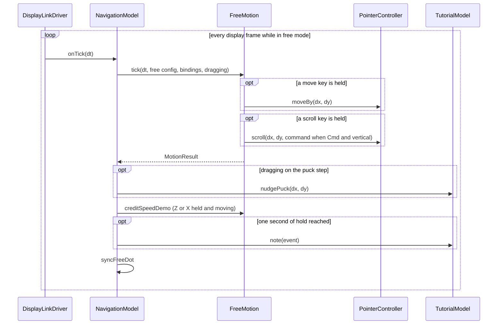

Held move keys add `speed × curve × fast/slow × dt` points. `AccelCurve` maps how long the direction has been held to a fraction of top speed. `linear` is already at the top, `diagonal` ramps there, `glide` is the tuned curve. Scroll uses the same curve and posts whole pixels, keeping the fraction for the next frame. ⌘ plus a vertical scroll keeps the ⌘ flag on the event so the app underneath zooms. Horizontal scroll stays plain.

`SpeedModifierLatch` exists because a move-key or scroll-key report drops Z and X, so those keys look released while the finger is still down. A release waits 50 ms, and longer while a move or scroll key is down. If HID still says the key is down, the release is thrown away.

## Hint

`enterHint` bumps a generation and loads targets off to the side. A newer enter, or leaving hint, drops a stale result.

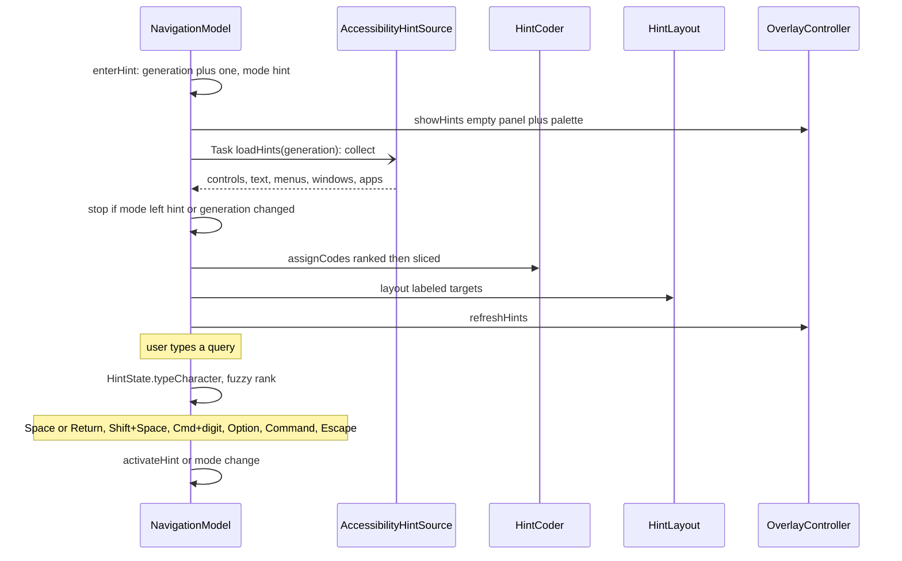

`AccessibilityHintSource` reads the focused app on a background task: clickable roles and the menu bar get yellow labels; static text, nested menus, open windows, and installed apps are search-only. Web areas get `AXManualAccessibility` and a second child read, plus `AXLinkUIElements`. Frames that cover most of the window are dropped. If the focused app is Unmouse itself, the scan walks `NSAccessibility` on the main actor instead.

`HintCoder` ranks targets (default, cancel, buttons, links, other window controls, then menu bar), boosts titles listed in `priority-words.txt`, and slices a mnemonic from the title (`Delete` → `d`, `Cancel` → `ca`, `search menu` → `sm`). Single-character codes stay in the focused window; menu bar items get two-or-more-character codes. Letter actions such as `a` / `s` / `d` stay in grid and free mode so the full `hint.chars` alphabet can label and search. `HintFuzzy` ranks a query with a subsequence score (spaces in the query are dropped); an exact hint code always wins. After three typed characters, the top nine hits get ⌘1–⌘9. `HintLayout` places the yellow bubbles. Space or Return activates the selected row; Shift+Space or Shift+Return right-clicks; alone Option moves there and enters free mode; alone Command opens the grid; Escape cancels.

## The pointer

Two coordinate systems. AppKit's origin is the bottom-left of the primary display, y up. `CGEvent`'s origin is the top-left, y down. Grid frames, overlays, and hint frames are AppKit. Accessibility frames arrive as `CGEvent` and are converted on the way in. `CoordinateSpace` does both conversions, and `PointerController` speaks `CGEvent`.

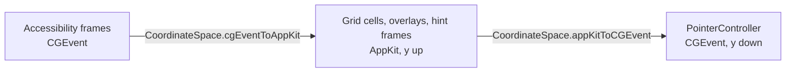

`NSEvent.mouseLocation` stays on the previous point until the window server applies a move. A click that reads it in that gap lands on the old point and undoes the move. `PointerAim` remembers the point we posted and the system location at that moment, and `PointerController.location` keeps returning the posted point until the system catches up.

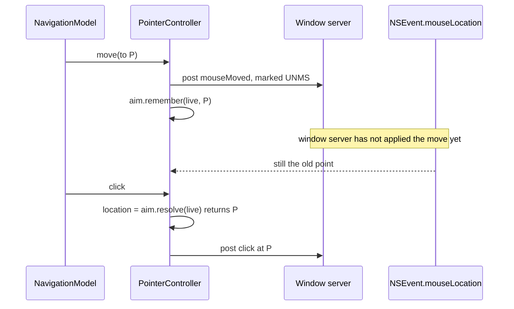

Posted events use a private event source and carry `eventSourceUserData` of `UNMS`. The tap ignores anything with that mark, so our own moves and clicks are not treated as the user. `send` clears keyboard modifiers, except an explicit ⌘ on a zoom scroll. Without that, the Option that entered free mode becomes an Option-click and hides the app underneath.

Sub-pixel steps accumulate. A frame that moves less than one pixel is not dropped and is not posted as a later jump.

## Config

`AppConfig` is one TOML file: `input`, `log`, `grid`, `free`, `hint`, `colors`, `bindings`. Bindings stay strings in the file. `BindingTable` parses them once when a config is applied, and key matching does not parse again.

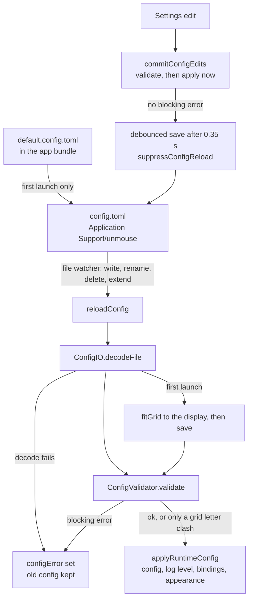

The first launch copies `default.config.toml` out of the app bundle and sizes the grid to the display under the pointer. The scripts copy `configs-example/` into the bundle. That directory is the only copy. `ConfigTests` reads it from the repo root.

`ConfigValidator` checks depth, duplicate characters, charset size, and duplicate or unparsable shortcuts. A grid shortcut that collides with a grid letter is reported and does not block the rest of the file.

`suppressConfigReload` stops our own write from reloading over the edit still on screen. `Open at login` is `SMAppService`, not a key in the file, so a preset cannot toggle it.

## What you see

Each panel is a `NSPanel` that is borderless and non-activating, sits at screen-saver level, ignores the mouse, and appears on every space.

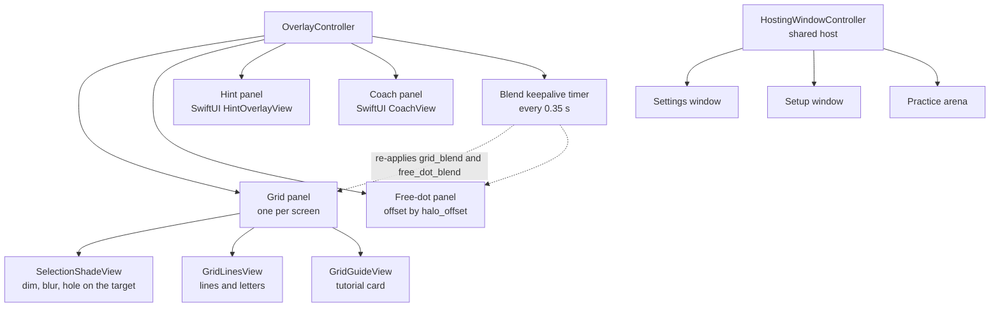

The grid is three AppKit views in one panel. The blur uses a private backdrop layer. If a future OS drops it, the dim remains. The timer does not redraw the letters.

The free-mode dot follows the pointer on every frame that moves it. Hints, the coach, Settings, the setup window, and the practice arena are SwiftUI.

## Tutorial

The steps and the rules for advancing them are `TutorialCatalog` and `TutorialProgress` in Core, which is why they have tests and no windows. `TutorialModel` runs a session, shows the practice arena, and stores finished sessions in `UserDefaults` under `tutorialCompleted`.

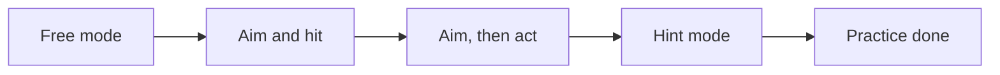

Sessions run in that order. Finishing one saves it and starts the next. Skipping ends the current session. Startup starts `freeOnly` unless it is already saved as done.

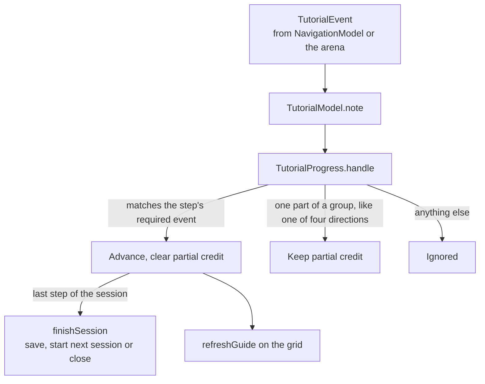

The arena reports a real hit (the green target, the orange target, the puck landing in the ring) through `AppModel.noteArena`. Grid steps draw their instruction on the cell, from `GridState.guide`, instead of in the practice window. While the drag step is holding the puck, the display-link tick moves it with `PuckDrop.nudge`.

## Changing something

| You want to | Open |
|---|---|
| Add or rename a binding | `Config/Bindings.swift`, then `Input/BindingTable.swift`, then the handler in `Input/NavigationModel.swift`, then Settings |
| Change how grid letters are assigned | `Grid/GridLabels.swift` |
| Change what a grid key does | `GridInputRouter` in `Grid/GridLogic.swift`, then `handleGridKey` |
| Change free-mode speed | `Motion/AccelCurve.swift` and `FreeMotion.tick` |
| Change a move, click, or scroll | `Pointer/PointerController.swift` |
| Change which controls get a hint | `Overlay/AccessibilityHintSource.swift` |
| Boost which titles win short codes | `Sources/UnmouseCore/Hint/priority-words.txt` |
| Change hint fuzzy ranking | `Sources/UnmouseCore/Hint/HintFuzzy.swift` |
| Change where hint bubbles sit | `Packages/BoundaryLabeling` |
| Change a practice step | `Tutorial/Tutorial.swift` (`TutorialCatalog`) |
| Change a preset | `configs-example/` |
